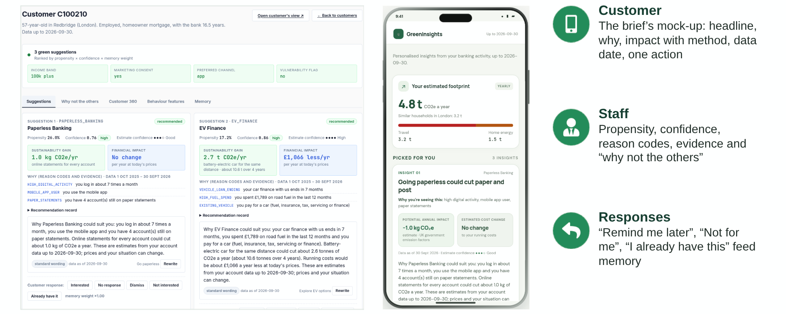
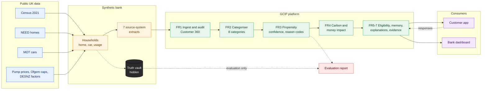

# Green Customer Insights Platform (GCIP)


**Second Prize, Megathon 2026.** Problem statement by Lloyds Banking Group India (PS1).

GCIP identifies which retail banking customers are suited to green products (EV finance, green home loans, solar finance, paperless banking, and two optional extensions), explains why, and quantifies the carbon and money impact of each recommendation.

## Approach

The brief prohibits real banking data, so the platform is built on a synthetic bank calibrated to UK public statistics. Each simulated household is given a physical reality first: a home sampled from DESNZ NEED, a car profile drawn from DVSA MOT records, and area context from Census 2021. The simulator determines litres, kWh and miles, then converts them into transactions at the weekly pump price and quarterly Ofgem cap in force.

The simulator's ground truth (true usage, hidden traits, take-up probabilities) is stored in a separate vault. Models never read it. The evaluation stage does, which allows accuracy to be measured against both the true values and the best achievable score.

## Pipeline



1. **Generate:** households first, bank statements second.
2. **Ingest (FR1):** seven source systems with differing formats, duplicates and orphan records are reconciled into one point-in-time view per customer. All 28.3M transactions are hash-verified against the vault.
3. **Categorise (FR2):** rules, merchant lookup, then text models. Accuracy is 99.0% on seen merchants and 90.4% on merchants unseen in training.
4. **Score (FR3):** one calibrated LightGBM model per product, with confidence and reason codes derived from feature contributions.
5. **Quantify (FR4):** deterministic impact using DESNZ 2026 factors, following GHG Protocol and PCAF.
6. **Explain (FR5-FR7):** template explanations by default, with optional LLM rephrasing behind guardrails that reject invented figures or promised savings.

## Key properties

- 36 of 36 validation checks against public statistics are within tolerance.
- Eligibility rules are applied before ranking, so a product the data rules out is never recommended.
- Customers flagged as vulnerable are routed to human review for credit products.
- Customer responses feed back into future recommendations, with fixed cool-down periods.
- Every recommendation carries its evidence, confidence, reason codes and data timestamp.

## Running the project

```bash
./run.sh              # launch dashboards on the prebuilt demo data
./run.sh --quick      # rebuild on 2,000 customers (about 3-5 minutes)
./run.sh --rebuild    # full rebuild on 30,000 customers
```

- Staff dashboard: http://localhost:8050
- Customer app: http://localhost:8050/app/

To score a snapshot or categorise transaction text with the saved models:

```bash
python scripts/predict.py propensity
python scripts/predict.py categorise
```

## Repository guide

| Item | Location |
|---|---|
| Library code | `src/gcip/` |
| Entry points | `scripts/` |
| Rules, thresholds, assumptions | `configs/` |
| Trained models | `demo/pipeline/models/` |
| Test-set predictions | `demo/pipeline/predictions/test_predictions.csv` |
| Architecture diagram | `docs/architecture/architecture.png` |
| Design explainer | `docs/EXPLAINER.md` |
| Evaluation report | `docs/EVALUATION.md` |
| LLM implementation | `docs/LLM.md` |
| Responsible AI note | `docs/RESPONSIBLE_AI.md` |
| Assumptions and limitations | `docs/ASSUMPTIONS_AND_LIMITATIONS.md` |
| Final report | `deliverables/final_report.pdf` |

## Limitations

Customers are synthetic, so reported metrics describe a realistic simulated bank rather than Lloyds' customer base. Coverage is England and Wales, with area context at local-authority level. All assumptions are labelled in `configs/`, and sensitivity analysis shows their effect.